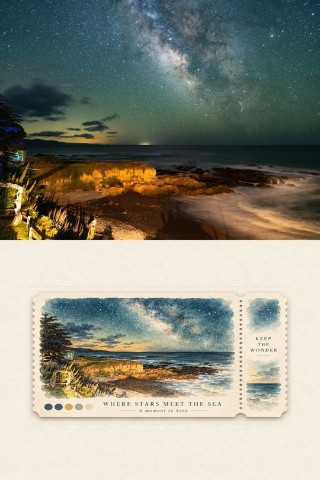
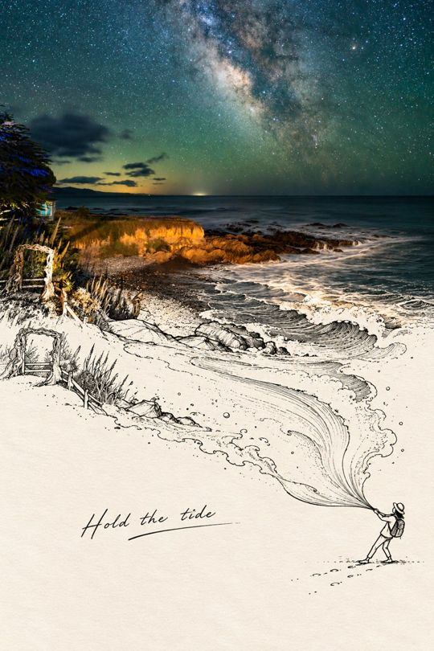
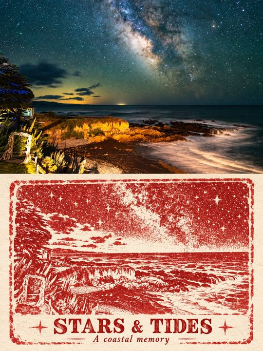
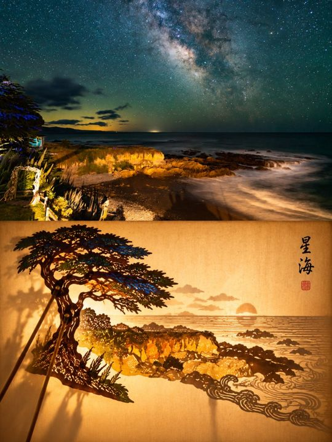

# Image Processing Skills

把一张照片，变成不同质感的旅行记忆。

这里收集可复用的图像处理 skills、原始提示词与效果样片。上传照片，选择一种风格，即可按对应的构图与质感规范制作海报。下方六张样片统一使用同一张**海岸银河**照片，便于直接比较。

## 风格速选

| 想要的效果 | Skill | 画幅 |
| --- | --- | --- |
| 旅行纪念票根 | [`travel-ticket-poster`](skills/travel-ticket-poster/SKILL.md) | 2:3 竖版 |
| 实景延伸线稿 | [`photo-line-art-poster`](skills/photo-line-art-poster/SKILL.md) | 2:3 竖版 |
| 实景延伸线稿 · 渐隐版 | [`photo-line-art-fade-poster`](skills/photo-line-art-fade-poster/SKILL.md) | 3:4 竖版 |
| 橡胶印章旅行记录 | [`rubber-stamp-travel-poster`](skills/rubber-stamp-travel-poster/SKILL.md) | 3:4 竖版 |
| 皮影戏偶 | [`shadow-puppet-poster`](skills/shadow-puppet-poster/SKILL.md) | 3:4 竖版 |
| 第二世界 | [`second-world-poster`](skills/second-world-poster/SKILL.md) | 3:4 竖版 |

## 样片与简介

### 旅行纪念票根

把旅途中的一张照片，变成可以收藏的纸质记忆。上半保留真实风景，下半将同一场景转译为轻盈水彩，装进带齿边、撕票区和柔和投影的奶油白票根。

**2:3 竖版 · 上下等高 · 水彩纸质票卡 · 系列尺寸与位置固定**

适合旅行纪念、风景摄影系列和需要统一版式的收藏海报。

<a href="skills/travel-ticket-poster/assets/sample.jpg"></a>

[查看 Skill](skills/travel-ticket-poster/SKILL.md) · [查看样片原图](skills/travel-ticket-poster/assets/sample.jpg)

### 实景延伸线稿

让照片中的一条真实线索，延伸成纸上的小小奇遇。海浪、道路或枝条从摄影中连续生长为纤细线稿，与一个小人物发生巧妙互动。

**2:3 竖版 · 上下等分 · 摄影与黑色钢笔线稿 · 小人物互动**

适合喜欢清晰分区、视觉隐喻和轻盈手绘感的旅行海报。

<a href="skills/photo-line-art-poster/assets/sample.jpg"></a>

[查看 Skill](skills/photo-line-art-poster/SKILL.md) · [查看样片原图](skills/photo-line-art-poster/assets/sample.jpg)

### 实景延伸线稿 · 渐隐版

让真实风景慢慢淡成一页想象。照片的背景色柔和融入近白纸面，只留下连续的线条与一个小人物，把旅途的情绪轻轻接住。

**3:4 竖版 · 中部柔和渐隐 · 无硬分界 · 大面积近白留白**

适合柔和、通透、诗意的摄影海报，尤其是水面、道路和倒影场景。

<a href="skills/photo-line-art-fade-poster/assets/sample.jpg"></a>

[查看 Skill](skills/photo-line-art-fade-poster/SKILL.md) · [查看样片原图](skills/photo-line-art-fade-poster/assets/sample.jpg)

### 橡胶印章旅行记录

像在旅途中盖下一枚只属于这个瞬间的纪念章。真实照片与手工拓印上下对照，用刻版轮廓、斑驳油墨和纸张纤维重新记录同一处风景。

**3:4 竖版 · 上下等高 · 手工拓印质感 · 每张专属英文文案**

适合旅行记录、复古纪念、独立出版物与版画风视觉。

<a href="skills/rubber-stamp-travel-poster/assets/sample.jpg"></a>

[查看 Skill](skills/rubber-stamp-travel-poster/SKILL.md) · [查看样片原图](skills/rubber-stamp-travel-poster/assets/sample.jpg)

### 皮影戏偶

把照片里的主角请上幕布，让它用一个姿态演完一出戏。主体被重新雕刻成镂空皮影，以半透明彩染、细竹签和温暖投影，呈现东方手工艺的光影层次。

**3:4 竖版 · 上下等高 · 镂刻皮影与关节 · 暖光宣纸幕布**

适合东方展览感、传统工艺转译，以及具有鲜明轮廓和姿态的主体。

<a href="skills/shadow-puppet-poster/assets/sample.jpg"></a>

[查看 Skill](skills/shadow-puppet-poster/SKILL.md) · [查看样片原图](skills/shadow-puppet-poster/assets/sample.jpg)

### 第二世界

照片下面，藏着一个可以被触摸和改变的世界。让水面、道路或光线跨过中线，在温暖纸面上变成照片碎片、剪纸形态与少量线稿，共同展开一个新的叙事。

**3:4 竖版 · 上下连续 · 照片碎片与剪纸 · 每张原创互动**

适合创意摄影拼贴、独立杂志视觉，以及希望从真实结构延伸想象的作品。

<a href="skills/second-world-poster/assets/sample.jpg"></a>

[查看 Skill](skills/second-world-poster/SKILL.md) · [查看样片原图](skills/second-world-poster/assets/sample.jpg)

## 使用

将所需 skill 的完整目录复制到你的 Codex skills 目录，在支持 skills 的会话中上传照片并调用：

```text
使用 $travel-ticket-poster，把这张照片做成旅行纪念票根海报。
```

其他风格只需替换 skill 名称。每张输入照片分别交付一张成品；实际生成需要运行环境提供图片查看和图像生成／编辑能力。浏览仓库不会自动安装 skill。

## 添加更多风格

每个 skill 独立放在 `skills/<skill-name>/`：

- `SKILL.md`：名称、简介、适用场景与执行约束。
- `references/original-prompt.md`：保留原始提示词及已知出处。
- `assets/sample.jpg`：一张对应效果样片，并在首页添加简介与图片链接。

样片展示风格与构图方向，具体细节随原照片变化；已明确的系列尺寸规范以对应 skill 为准。
