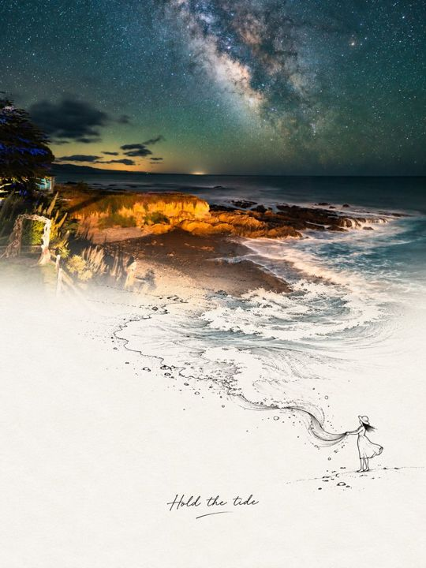

# 实景延伸线稿海报 · 渐隐版（Photo Line Art）

让真实风景慢慢淡成一页想象。照片的背景色柔和融入近白纸面，只留下连续的线条与一个小人物，把旅途的情绪轻轻接住。

**风格与版式**：3:4 竖版 · 中部柔和渐隐 · 无硬分界 · 大面积近白留白。

适合柔和、通透、诗意的摄影海报，尤其是水面、道路和倒影场景。

## 样片

*统一使用海岸银河照片展示各 skill 的效果；样片用于风格预览，具体构图按输入照片设计。*

使用图片编辑能力将用户照片转化成一张独立的竖版海报。原始创作提示词保存在 [references/original-prompt.md](references/original-prompt.md)，生成时读取并作为完整视觉约束，结合当前照片和用户明确要求执行。

## 输入与执行

- 先查看用户提供的照片，分析主体、结构与可向下延伸的真实元素（倒影、水流、道路、绳索、枝条、动物尾部、物体轮廓等）。没有可访问的参考图片时，请用户上传；不得凭空生成替代原照。
- 如有多张照片且主体图不明确，询问使用哪张；用户已经指定时直接执行。
- 连接创意必须按当前照片原创设计：延伸元素、互动方式（牵引、触碰、攀爬、托举、坐靠、沿路行走等）都应因图而异，不得套用固定模板，不得为了连接而凭空添加照片中不存在的绳子等元素。
- 使用当前环境提供的图像生成／编辑工具，并把原照片作为实际图片引用输入。若环境提供 imagegen skill，按其图像编辑流程执行；不要仅提交文字描述冒充图片引用。工具不可用时明确说明限制。
- 画布为竖版 3:4（例如 1152 × 1536）。上下两部分各占约 50%，但不画出分界线。
- 默认交付一张完整海报。不得把本次请求扩大为发布、上传至外部图库或修改用户原文件。

## 不可丢失的设计约束

1. **照片保留**：上半部分约占画面 50%，保留原照片的主体、结构、姿态、自然光影、色彩和真实摄影质感，仅做轻微精致调色；可自然延展背景适配画幅，不得拉伸、扭曲主体，不要把照片重绘成插画。
2. **创意连接**：选定的真实元素必须从照片中准确的原始位置连续延伸，穿过画面中线，逐渐由真实摄影质感转化为纤细的黑色钢笔线稿，再与下方小人物产生明确互动；互动要有巧思、动作自然、接触位置准确。
3. **自然过渡**：照片中的水面、地面或背景色在画面正中附近逐渐淡入接近白色的纸面，过渡柔和、自然、有层次，同时保持主要连接元素清晰连续；不得出现横向硬切、矩形照片边缘、空隙、错位或线条重新起笔。
4. **下方线稿**：下半部分大量留白，纸面接近白色，只有非常轻微的细纤维纹理，不泛黄。黑色钢笔线稿人物约占整张画面高度的 7%—10%，无清晰五官，服装与道具简化，线条纤细、略微不规则、松弛自然；肢体比例与透视正确，与延伸元素形成真实可读的接触关系；不要完整复刻上方场景。
5. **文字**：根据画面生成一句 2—5 个英文单词的温柔短句，小字号、轻盈手写体，放在下方留白处，作为情绪旁白，不抢主体。
6. **整体审美**：真实摄影、极简线稿、克制留白、鲜明但自然的色彩、诗意的视觉隐喻、精致的编辑设计感。
7. **禁止项**：上下断开、孤立小人、无支撑悬浮、巨大人物、复杂五官、Q 版动漫、粗黑轮廓、密集速写、灰暗脏污、油腻反光、过黄纸面、大标题、边框、网格、角标、水印。

## 检查与交付

检查实际成图：上半是否为原照保留、主体未被重绘、拉伸或变形；中部过渡是否柔和渐隐、无硬切、无矩形照片边缘；延伸元素是否从原始位置连续穿过中部、质感转换自然、且与小人物接触准确；小人物比例是否在画面高度 7%—10%、无清晰五官、肢体比例透视正确；英文短句是否为 2—5 词、字号克制且拼写正确；是否触犯任一禁止项。发现偏差时针对问题修改；工具无法保证渐隐过渡或连续性精度时如实说明，不能声称通过检查。

直接展示或链接最终成图。仅在用户要求时额外提供提示词或变体。
